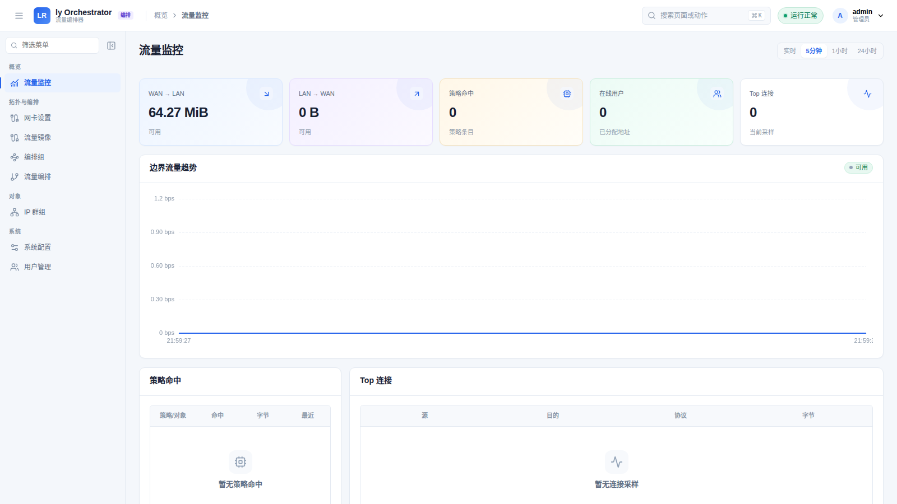
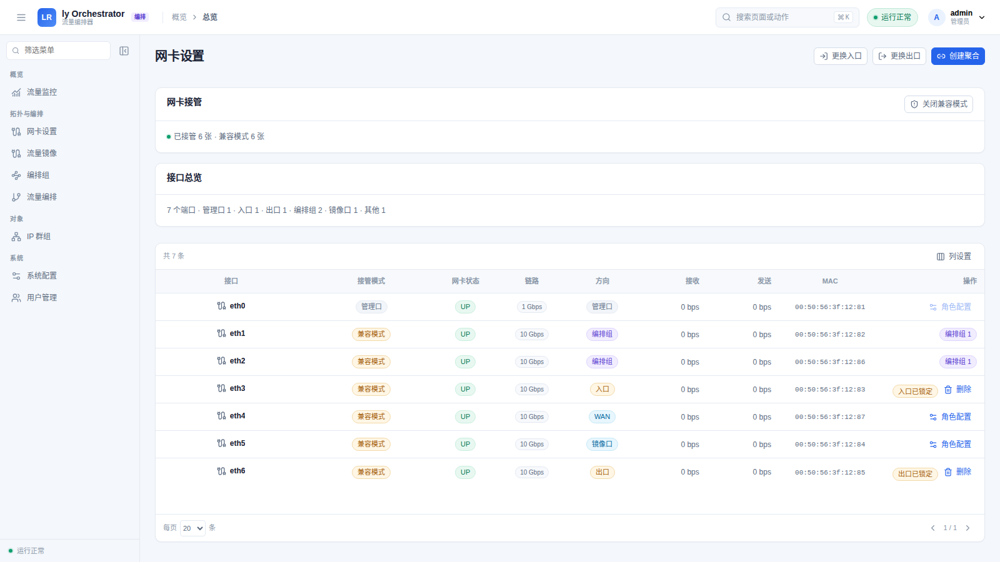
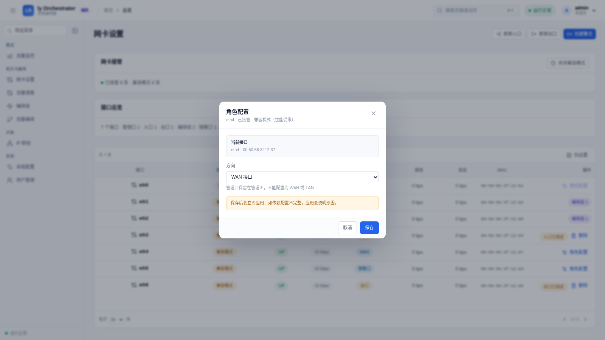
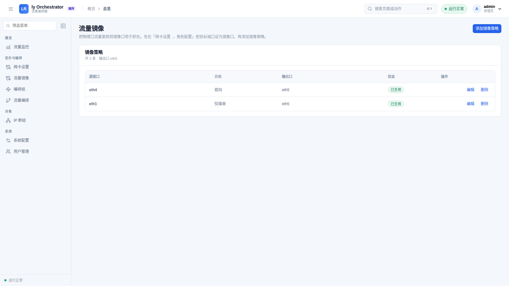
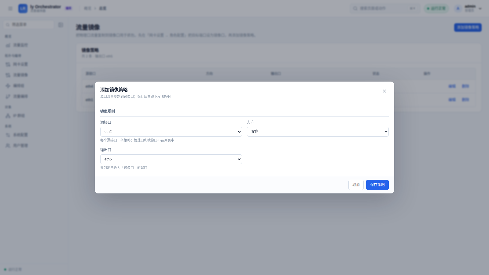
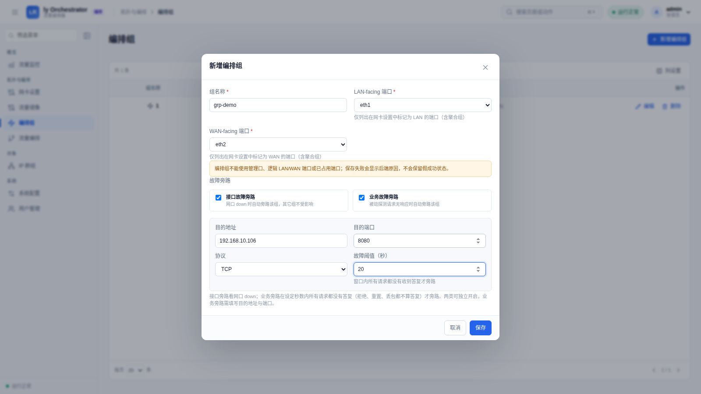
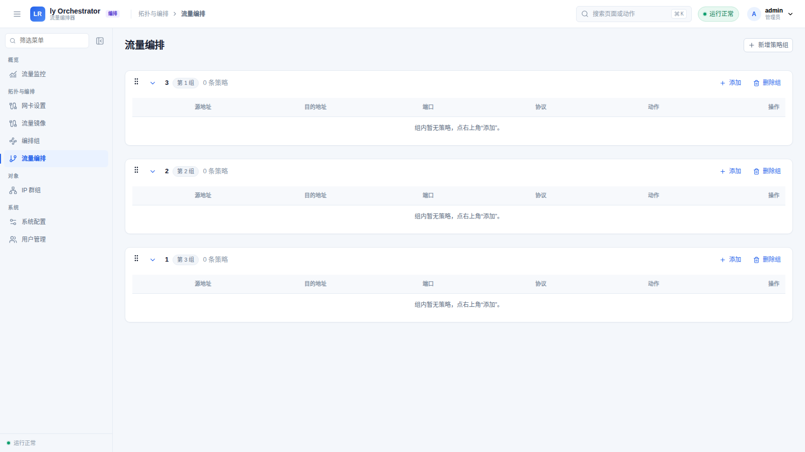
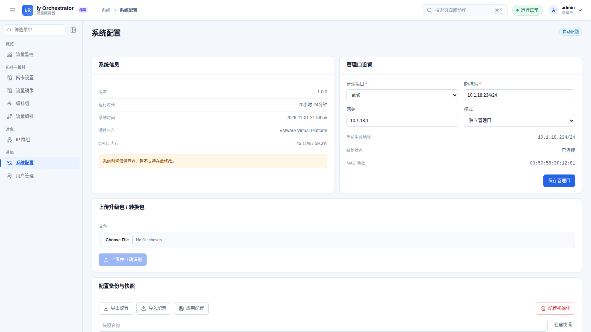

# ly Orchestrator 流量编排器

**透明串接的流量编排平台。** 把安全设备、审计设备或任意服务节点以「编排组」的形式
透明接入网络，按策略引流、按组旁路、按需镜像，全程不改变现有 IP 与路由。

当前版本：**1.0.3**（x86_64）



> **发布仓库说明**：本仓库只包含安装/升级产物、打包工程与第三方组件声明。
> 产品源代码不公开，软件使用受 [EULA](EULA.md) 约束。

## 下载

最新正式版：**[v1.0.3](https://github.com/kwrum1/ly-orchestrator/releases/tag/v1.0.3)**

| 形态 | 产物 | 用途 |
| --- | --- | --- |
| 裸机安装 | [`ly-route-orchestrator-1.0.3-amd64.iso`](https://github.com/kwrum1/ly-orchestrator/releases/download/v1.0.3/ly-route-orchestrator-1.0.3-amd64.iso) | BIOS/UEFI 安装 |
| 在线升级 | [`ly-route-orchestrator-1.0.3-amd64.tar.zst`](https://github.com/kwrum1/ly-orchestrator/releases/download/v1.0.3/ly-route-orchestrator-1.0.3-amd64.tar.zst) | 1.0.x 原地升级 |

校验文件：[`SHA256SUMS`](https://github.com/kwrum1/ly-orchestrator/releases/download/v1.0.3/SHA256SUMS)

## 产品定位

ly Orchestrator 部署在网关与业务网络之间，以两个物理口组成一条透明通道。流量进入
编排组后按策略直通、丢弃或经过服务链，业务侧无需修改地址、网关或客户端配置。

- **透明串接**：不改变现有网络拓扑与 IP 规划。
- **按组编排**：每组两个方向端口，策略以组为单位进入服务链。
- **故障不中断**：接口故障或业务请求持续无响应时，只旁路受影响的组。
- **可视化运维**：实时流量、在线用户、会话与趋势一屏可见。

## 安装

### 要求

- x86_64 平台；
- 至少 2 张数据网卡（WAN-facing / LAN-facing），另需管理口；
- 4 GB 以上系统盘；
- BIOS 或 UEFI 启动。

### ISO 安装

1. 下载 ISO，用 `dd` 或 balenaEtcher 写入 U 盘；
2. 目标机选择 BIOS/UEFI 启动，进入安装器；
3. 选择目标磁盘、管理网口，设置管理地址与管理员密码；
4. 执行安装并重启。

首次启动后浏览器访问 `https://<管理地址>/` 进入编排器控制台。首次登录强制改密。

### 升级

控制台：**系统 → 升级 / 回滚**，上传 `ly-route-orchestrator-<version>-amd64.tar.zst`，
确认后执行。升级保留业务配置，失败可回滚到上一版本。

## 核心功能

### 拓扑与网卡角色

按端口分配 **LAN / WAN / 镜像口 / 未配置** 四种角色；管理口保留在管理面，不参与
数据面转发。角色变更即时校验并下发，方向列直接显示端口用途。





### 链路聚合

支持将两张同速率物理口组成聚合组，提升带宽与链路冗余；兼容模式端口会在创建前被
明确拦截并说明原因，避免把整笔下发拖入失败。

### 流量镜像

单一镜像目的口、多个源口并行复制；每条策略独立选择源接口、方向（双向/仅接收/
仅发送）与输出口。策略保存即下发，`vppctl show interface span` 可实时核对会话。





### 编排组

每组由一对方向端口组成（LAN-facing / WAN-facing），是策略、服务链与故障旁路的
最小单元。支持新增、编辑、删除；组端口与入口/出口、管理口、聚合口互斥校验。


### 故障旁路

每个编排组可独立开启两类旁路：

- **接口故障旁路**：组内网口 down 即旁路该组，其它组不受影响。
- **业务故障旁路**：按目的地址、目的端口、协议与阈值（秒）被动探测；规定时间内
  所有请求都没有收到答复才旁路。拒绝、重置（RST）、丢包都不算答复。

故障恢复后自动回到策略路径；旁路配置随组保存、随组删除。



### 流量编排与 IP 群组

策略组内规则按顺序首条命中生效，支持源/目的地址、端口、协议以及直通、丢弃、
经过编排组三类动作。IP 群组可直接在规则编辑器中引用，也可直接填写 CIDR。



### 可观测

流量监控提供 WAN→LAN / LAN→WAN 实时速率、边界流量趋势、在线用户、Top 连接与
策略命中。采集带短周期缓存，下发窗口内不会误报「数据暂不可用」；真实采集失败会
给出具体原因。

### 升级与配置管理

支持在线升级、配置快照、配置导出/导入（预检 + 确认 + 回滚快照）、产品转换与
固件升级。导入包默认排除密钥材料，含密钥字段的包会被拒绝。



## 完整性校验

```bash
sha256sum -c SHA256SUMS
```

v1.0.3 的 SHA256：

```text
0651e9ed8dc679fbd9e7899506e9b2a4a2a0c25329322cf7aede0fa71c9597b5  ly-route-orchestrator-1.0.3-amd64.tar.zst
064ffce23181a0a477731b0791264a98bfe0de0d483e542d21ab3d8bf2131973  ly-route-orchestrator-1.0.3-amd64.iso
```

## 仓库结构

```text
.
├── README.md
├── EULA.md
├── NOTICE.md
├── THIRD-PARTY.md
├── SECURITY.md
├── licenses/
├── docs/
│   ├── images/               产品界面截图
│   ├── INSTALL.md
│   ├── UPGRADE.md
│   └── PACKAGING.md
├── packaging/                ISO 组装脚本（不含产品源码）
└── .github/workflows/        GitHub Actions：从二进制输入组装 ISO 并发布
```

## 打包与 CI

本仓库的 CI **不编译产品源码**。它从上一版 ISO（启动骨架）与目标版本的升级包组装
ISO，并上传到 Release。见 [docs/PACKAGING.md](docs/PACKAGING.md)。

## 版本与平台

- 当前正式版本：`1.0.3`
- 仅发布 x86_64（amd64）产物。

## 许可证与第三方组件

- 产品本身为闭源商业软件，使用条款见 [EULA.md](EULA.md)；
- 第三方组件清单与上游源码地址见 [THIRD-PARTY.md](THIRD-PARTY.md)；
- 许可证全文见 [`licenses/`](licenses/)。

## 问题反馈

- 功能与安装问题：GitHub Issues；
- 安全漏洞：请按 [SECURITY.md](SECURITY.md) 私下报告。
