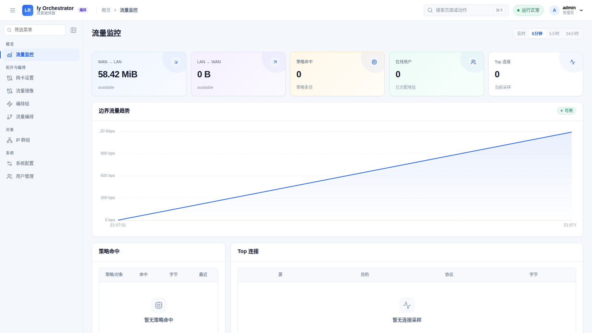
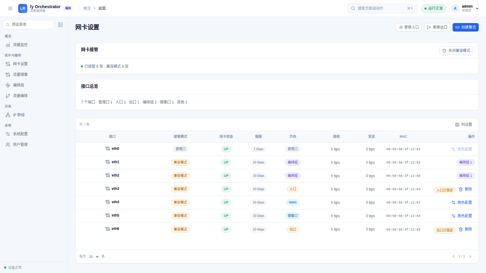
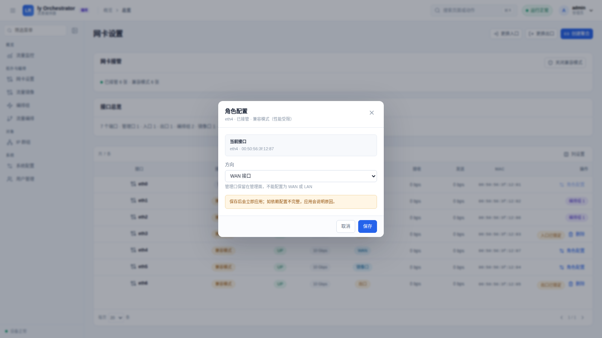
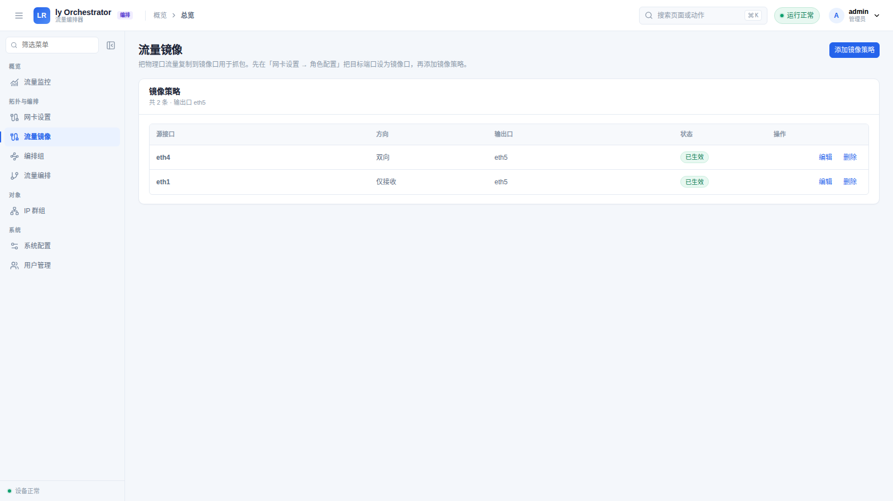
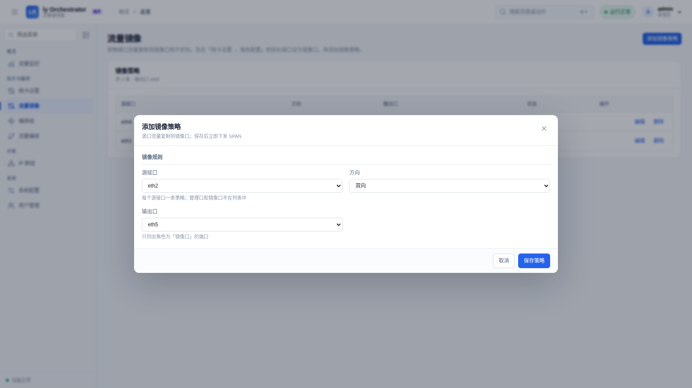
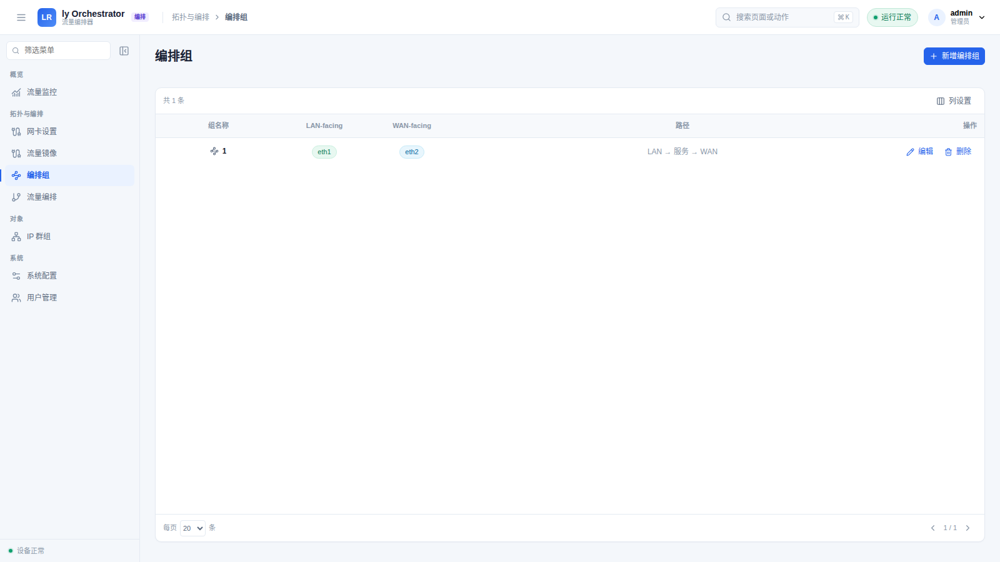
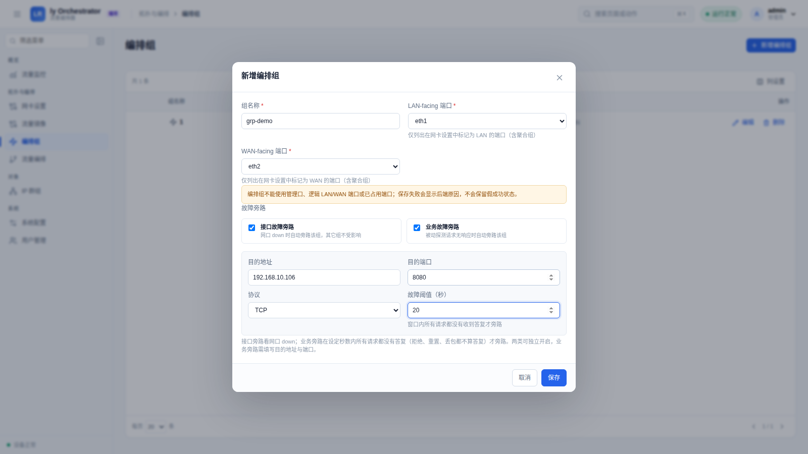
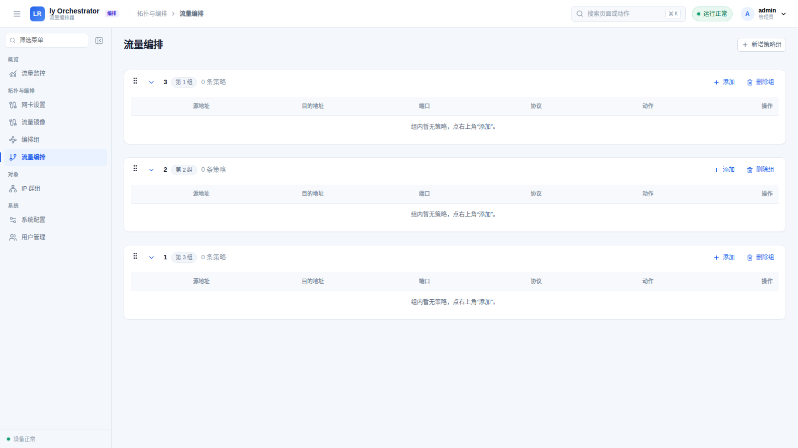
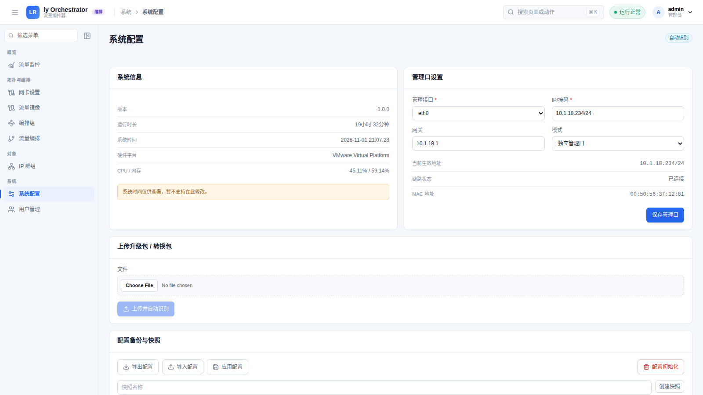

# ly Orchestrator 流量编排器

**透明串接的流量编排平台。** 把安全设备、审计设备或任意服务节点以「编排组」的形式
透明接入网络，按策略引流、按组旁路、按需镜像，全程不改变现有 IP 与路由。

当前版本：**1.0.3**（x86_64）

## 产品定位

ly Orchestrator 部署在网关与业务网络之间，以两个物理口组成一条透明通道。流量进入
编排组后按策略直通、丢弃或经过服务链，业务侧无需修改地址、网关或客户端配置。

- **透明串接**：不改变现有网络拓扑与 IP 规划。
- **按组编排**：每组两个方向端口，策略以组为单位进入服务链。
- **故障不中断**：接口故障或业务请求持续无响应时，只旁路受影响的组。
- **可视化运维**：实时流量、在线用户、会话与趋势一屏可见。

## 核心功能

### 拓扑与网卡角色

按端口分配 **LAN / WAN / 镜像口 / 未配置** 四种角色；管理口保留在管理面，不参与
数据面转发。角色变更即时校验并下发，方向列直接显示端口用途。

### 链路聚合

支持将两张同速率物理口组成聚合组，提升带宽与链路冗余；兼容模式端口会在创建前被
明确拦截并说明原因，避免把整笔下发拖入失败。

### 流量镜像

单一镜像目的口、多个源口并行复制；每条策略独立选择源接口、方向（双向/仅接收/
仅发送）与输出口。策略保存即下发，`vppctl show interface span` 可实时核对会话。

### 编排组

每组由一对方向端口组成（LAN-facing / WAN-facing），是策略、服务链与故障旁路的
最小单元。支持新增、编辑、删除；组端口与入口/出口、管理口、聚合口互斥校验。

### 故障旁路

每个编排组可独立开启两类旁路：

- **接口故障旁路**：组内网口 down 即旁路该组，其它组不受影响。
- **业务故障旁路**：按目的地址、目的端口、协议与阈值（秒）被动探测；规定时间内
  所有请求都没有收到答复才旁路。拒绝、重置（RST）、丢包都不算答复。

故障恢复后自动回到策略路径；旁路配置随组保存、随组删除。

### 流量编排与 IP 群组

策略组内规则按顺序首条命中生效，支持源/目的地址、端口、协议以及直通、丢弃、
经过编排组三类动作。IP 群组可直接在规则编辑器中引用，也可直接填写 CIDR。

### 可观测

流量监控提供 WAN→LAN / LAN→WAN 实时速率、边界流量趋势、在线用户、Top 连接与
策略命中。采集带短周期缓存，下发窗口内不会误报「数据暂不可用」；真实采集失败会
给出具体原因。

### 升级与配置管理

支持在线升级、配置快照、配置导出/导入（预检 + 确认 + 回滚快照）、产品转换与
固件升级。导入包默认排除密钥材料，含密钥字段的包会被拒绝。

## 部署形态

| 形态 | 产物 |
| --- | --- |
| 在线升级 | `ly-route-orchestrator-1.0.3-amd64.tar.zst` |
| 裸机安装 | `ly-route-orchestrator-1.0.3-amd64.iso` |

安装 ISO 支持 BIOS/UEFI 启动，安装时选择目标磁盘与管理口，写入管理地址后首次启动
即进入编排器控制台。系统要求：x86_64、至少 2 张数据网卡、4 GB 以上系统盘。

## 版本

- 当前正式版本：`1.0.3`
- 仅发布 x86_64（amd64）产物。

## 文档

- 产品与界面截图：`docs/images/`
- 维护者边界说明：`docs/REPO-BOUNDARY.md`
- 编排组故障旁路语义：`docs/orchestrator-per-group-bypass.md`
- 服务集与运行边界：`docs/orchestrator-service-units.md`
